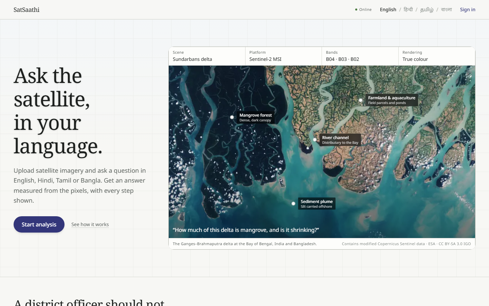
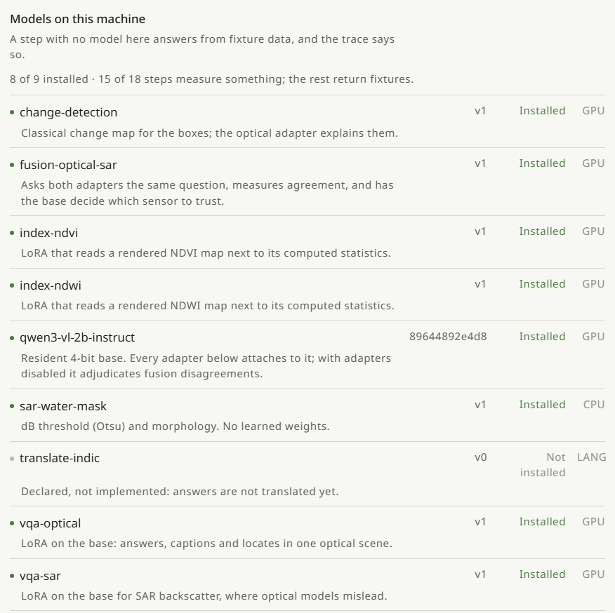
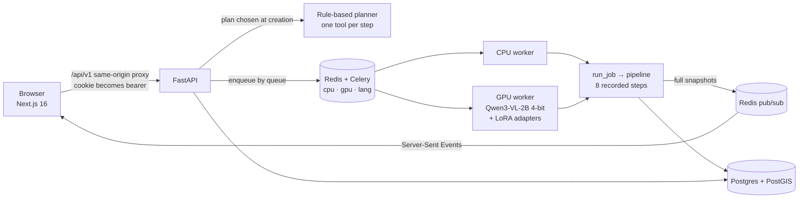
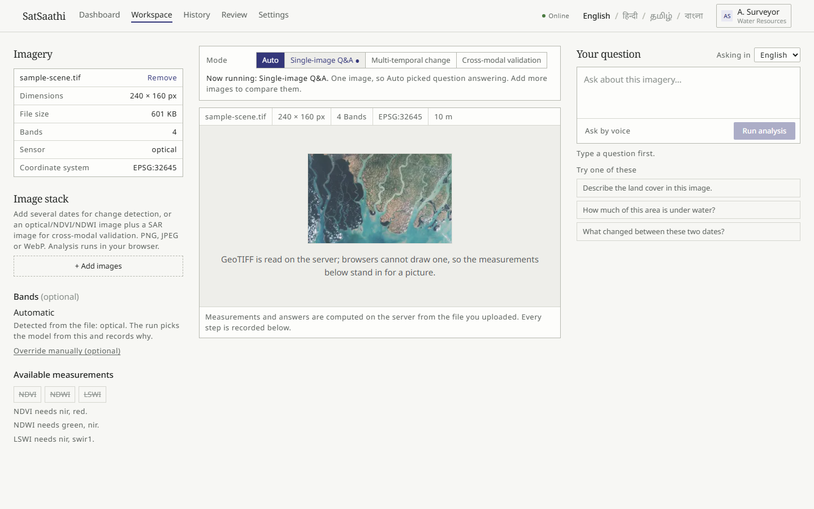
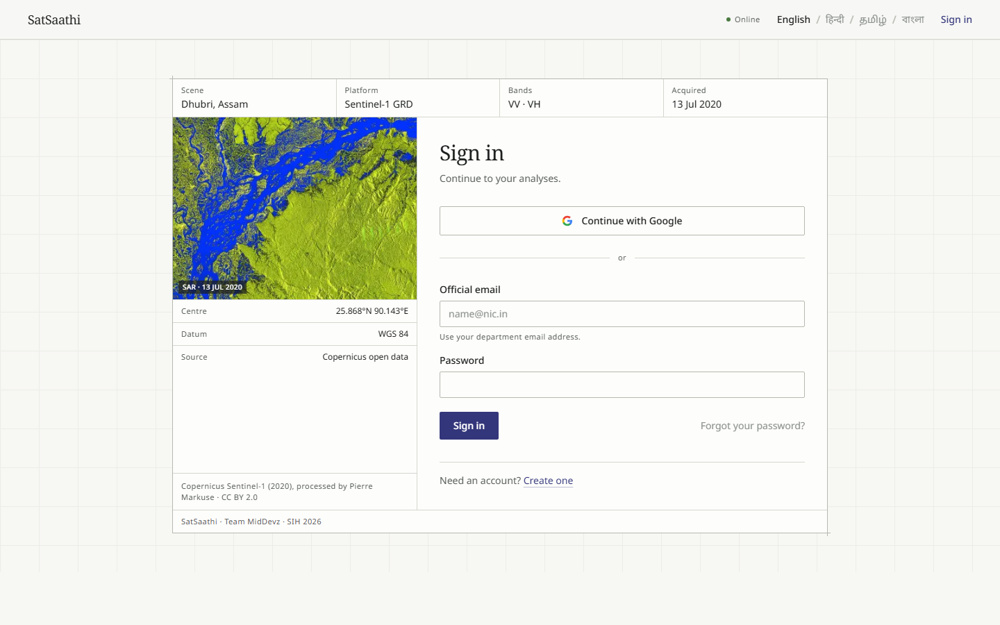

# SatSaathi

### Ask the satellite, in your language.

SatSaathi is a copilot for district officers who need answers from satellite imagery but are not remote-sensing specialists. Upload a scene, ask a question in **English, Hindi, Tamil or Bangla**, and get an answer that is **measured from the pixels** — with every step of how it got there shown and recorded.

Built by **Team MidDevz** for **Smart India Hackathon 2026**, ISRO problem statement **SIH26167**: *SatQuery AI — an interactive vision-language assistant for multimodal remote-sensing image analysis through text queries.*



---

## Why this exists

Satellite expertise sits in a few national centres. A field officer typically receives a static flood map and cannot ask a follow-up. Radar (SAR) needs specialist training to read; optical imagery is blind under monsoon cloud; and general-purpose AI chatbots will happily invent a number — they cannot read NIR, SWIR or SAR bands at all.

SatSaathi is built around one rule: **compute, don't guess.** Hectares and spectral indices come from pixel arithmetic. A vision-language model describes and locates things, but its claims are checked against the computed numbers, and anything the system is not sure about goes to a human expert instead of to the officer.

## What makes it different

| | |
|---|---|
| **Numbers come from pixels** | NDVI, NDWI and LSWI are computed from the NIR/SWIR bands (the indices the YES-TECH crop-yield programme relies on). Area comes from the pixel size on the ground (or ellipsoidal area for geographic coordinates), not from a pixel count. |
| **Bands are never substituted** | If a file has no near-infrared band, NDVI is reported as *unavailable* and says which band it needed. It is never approximated from visible light. |
| **No coordinate system, no area** | An image without a CRS has no ground size. SatSaathi reports that, rather than inventing a pixel size. |
| **A confidence gate** | An answer scoring below **0.75** is held and sent to an expert review queue. It is never auto-released. |
| **The trace is the product** | Every query runs eight fixed steps. Each is recorded — the tool, its permitted parameters, its duration, and whether it **measured** something or returned **fixture** output. The trace is versioned, persisted, and downloadable as JSON. |
| **Honest about its own limits** | A step that did not run a real model says so — on screen, in the API, and in the exported trace. A missing model is reported, never silently papered over. |



*The settings screen lists every model the system knows about and whether it is actually on this machine. One is deliberately shown as "Not installed" — that is the point.*

## How a question becomes an answer

Every query passes through the same eight steps. The step keys are shared by the backend, the frontend, the translation catalogues and the exported trace.

| # | Step | What happens |
|---|---|---|
| 1 | **ask** | The question is received, in any of the four languages |
| 2 | **imagery** | The GeoTIFF is read on the server: size, bands, sensor, CRS, footprint |
| 3 | **understand** | The question is routed to a task: VQA, caption, grounding, change, or fusion |
| 4 | **preprocess** | Co-registration for before/after and optical+SAR pairs |
| 5 | **compute** | Spectral indices and area in hectares, from real bands |
| 6 | **vision_language** | The routed vision-language adapter answers, describes or locates |
| 7 | **verify** | Claims are cross-checked against computed numbers; low confidence is held |
| 8 | **answer** | The result is written up for the officer |



The planner is deliberately simple — a table, not reasoning — so the task and tool chosen for a query are an explicit, recorded decision rather than something to guess at afterwards.

## What works today

**Working:**

- Sign-up and sign-in with email and password (Argon2id), and **Sign in with Google** (state + PKCE, ID token verified server-side, linked to an existing account only when Google confirms the email is verified)
- GeoTIFF upload, read on the server — **GeoTIFF/TIFF only**, enforced by extension, by the file's actual bytes, and in the browser before anything is sent
- Spectral indices (NDVI, NDWI, LSWI) with area in hectares, for sensors with the bands to support them; band presets for Sentinel-2, Landsat 8/9, Resourcesat-2 LISS-III / LISS-IV, Cartosat-2S, Sentinel-1 and EOS-04/RISAT
- Task routing across VQA, captioning, visual grounding, change detection and optical–SAR fusion
- Live eight-step trace streamed to the browser, JSON trace export, GeoJSON footprint export
- Confidence gate and expert review queue; dashboard and history
- Interface in English, Hindi, Tamil and Bangla
- Model-backed answers from LoRA adapters on a resident 4-bit Qwen3-VL-2B base, when a GPU worker and the weights are present

**Not built yet** (planned in the project proposal): voice input and spoken replies, the claim-report PDF, IndicTrans2/Bhashini translation of answers, an LLM answer composer, and a trained intent classifier. The Hindi, Tamil and Bangla interface text is machine-drafted and **awaiting review by native speakers**. Confidence scores on test images are currently low (roughly 31–49 %), so most answers are held for review until the adapters are calibrated.





## Quick start

### Prerequisites

- **Docker Desktop** (Compose v2)
- For development outside Docker: **Node 24**, **pnpm 12.5.1** (`corepack enable`), **Python 3.12**, and **[uv](https://docs.astral.sh/uv/)**
- For the real model: an **NVIDIA GPU** with a CUDA-capable PyTorch install (see below)

### 1. Try it in Docker (no GPU needed)

```bash
git clone https://github.com/rsd-06/sat_saathi.git
cd sat_saathi
cp .env.example .env
make dev
```

| Service | URL |
|---|---|
| Web app | http://localhost:3000 |
| API (docs at `/docs`) | http://localhost:8000 |
| Tile server | http://localhost:8001 |
| Postgres + PostGIS | `localhost:5432` |
| Redis | `localhost:6379` |

Open the web app, **create an account**, and upload a GeoTIFF — `infra/fixtures/sample-scene.tif` is a small 4-band, 10 m GeoTIFF you can use. With no model weights installed, indices and area are still computed from the real pixels, while the vision-language steps return fixture text **and are labelled as such** in the trace. Check the stack with:

```bash
curl http://localhost:8000/api/v1/health
```

`make down` stops everything.

### 2. Run the full stack with the real model

This is the demo configuration: web on **:3100**, API on :8010, a CPU worker and a GPU worker.

```bash
# once: create the containers (Postgres, Redis, tiler)
docker compose -f infra/compose/docker-compose.yml --profile core up -d postgres redis tiler

uv sync --all-packages --extra gpu     # torch, peft, bitsandbytes — GPU machine only
pnpm install --frozen-lockfile

bash scripts/stack.sh up
# then open http://localhost:3100
```

Uploads, weights and logs go in `.data/` (override with `SATSAATHI_DATA`). `stack.sh` also runs one piece at a time in the foreground: `migrate`, `api`, `cpu`, `gpu`, `web`. On Windows, run it from Git Bash. The first question loads the model into GPU memory and takes a few minutes; later ones are fast, and the model unloads itself after a period of inactivity.

**Model weights are not in this repository.** The runtime expects them under `MODELS_DIR`:

```
$MODELS_DIR/
├── qwen3-vl-2b-instruct/<12-char commit>/   # base, from Hugging Face Qwen/Qwen3-VL-2B-Instruct
├── vqa-optical/v1/                          # LoRA adapters: adapter_config.json,
├── vqa-sar/v1/                              #   adapter_model.safetensors, eval.json
├── index-ndvi/v1/   index-ndwi/v1/
├── fusion-optical-sar/v1/   change-detection/v1/   sar-water-mask/v1/
```

Run `make models-doctor` to see exactly what the runtime can and cannot see. Anything missing is reported as *not installed* and its step falls back to labelled fixture output — the app still runs.

### Configuration

Secrets live in one gitignored file, **`.env.local` at the repository root**, read by both the Python services and the Next.js app. Real environment variables take precedence. `.env.example` is the committed template.

| Variable | Purpose |
|---|---|
| `SATSAATHI_MODE` | `online` (default) or `offline`. Offline always uses the local Postgres and refuses online-only providers. |
| `DATABASE_URL` | A hosted Postgres (e.g. Supabase). Leave empty to use the local Docker database. |
| `REDIS_URL` | Job queue and live-trace transport. Optional: without it, jobs run inline. |
| `JOB_DISPATCH` | `inline` (in the API process) or `celery` (on workers). |
| `STORAGE_DIR` / `MODELS_DIR` | Uploaded rasters / model weights. Kept apart on purpose. |
| `MAX_UPLOAD_MB` | Upload limit (default 512). |
| `GOOGLE_CLIENT_ID` / `GOOGLE_CLIENT_SECRET` | Enables Google sign-in. Empty means the button is hidden. |

**Google sign-in.** In the Google Cloud console create an *OAuth client ID* of type *Web application* and add `http://localhost:<port>/api/auth/google/callback` as an authorised redirect URI **for every port you serve the web app on** (3000 for Docker, 3100 for the full stack). Google refuses any redirect URI not registered exactly. While the consent screen is in *Testing* mode, add your own account as a test user.

**A hosted database.** Any Postgres with the **PostGIS** extension works. For Supabase use the *session pooler* string (it is IPv4; the direct host is IPv6-only), and percent-encode special characters in the password (`@` becomes `%40`). TLS is enabled automatically for non-local hosts.

## Development

```bash
pnpm lint && pnpm typecheck && pnpm test      # JavaScript
pnpm --filter @satsaathi/i18n check           # every key present in all four languages

uv run ruff check .                           # Python
uv run python -m pyright
uv run --package satsaathi-core pytest python/core/tests
uv run --package satsaathi-api  pytest apps/api/tests    # needs DATABASE_URL, else skips

make test      # everything
```

Database migrations (from `python/core`): `uv run alembic upgrade head`, or `alembic revision --autogenerate -m "…"` for a new one. Round-trip every migration (upgrade, downgrade, upgrade) before committing.

> Tests that need Postgres **skip silently** when `DATABASE_URL` is unset, and the API test suite refuses to run against a non-local database unless you set `SATSAATHI_ALLOW_REMOTE_TESTS=1`. It creates and deletes rows freely.

**Windows.** Keep the repository off OneDrive (it will try to sync `node_modules`). The workers use the solo pool because Windows has no `fork`. If you use WSL2, clone *inside* the WSL filesystem — Docker bind mounts and Next.js file-watching are slow across the boundary.

### Adding or changing interface text

Translations live in `packages/i18n/messages/{en,hi,ta,bn}.json` as flat dotted keys — the single source of truth for both the web app and the Python services. Add the key to **all four** files; `pnpm --filter @satsaathi/i18n check` fails the build otherwise. The API never sends user-facing English: it sends `{ "key": …, "params": … }` and the browser chooses the words. Track new machine translations in the matching `*.review.json` under `entries` until a native speaker signs off.

## Repository map

```
apps/
  web/             Next.js 16 App Router — locale-prefixed routes, the workspace, auth, same-origin API proxy
  api/             FastAPI — assets, input sets, jobs (+ SSE), review, auth, model status
  worker/          Celery — the CPU/lang worker and the solo-pool GPU worker
python/
  core/            Settings, DB models + migrations, raster and index maths, storage, event bus
  models/          The model catalog: what exists and whether it is installed (stdlib only)
  inference/       The GPU runtime — one resident 4-bit base, adapters swapped per call (lazy torch)
  tools/           The tools, the planner, the pipeline, and the trace schema
  jobs/            Running one job and broadcasting its progress — shared by API and worker
packages/
  i18n/            The four-language catalogues and the parity checker
  api-client/      Typed client generated from the API's OpenAPI schema
infra/             Docker Compose, Dockerfiles, test fixtures
scripts/stack.sh   The full demo stack on one port
docs/              Architecture notes and decision records
```

For the reasoning behind how the pieces fit — including the rules that keep the trace honest — read [`CLAUDE.md`](CLAUDE.md) and [`docs/architecture.md`](docs/architecture.md). Note that `docs/superpowers/` holds the original early-phase plans and is historical.

## Tech stack

**Frontend:** Next.js 16, React 19, TypeScript (strict), Tailwind CSS v4, next-intl, self-hosted Noto fonts for Devanagari, Tamil and Bengali · **Backend:** FastAPI, Pydantic v2, SQLAlchemy 2 (async), Alembic, Celery, Redis · **Geospatial:** PostgreSQL + PostGIS, Rasterio/GDAL, Shapely, pyproj, TiTiler · **AI:** PyTorch, Qwen3-VL-2B (4-bit) with LoRA adapters via PEFT, bitsandbytes · **Tooling:** pnpm + Turborepo, uv, Ruff, Pyright, Vitest, Playwright, Docker

## Roadmap

From the project proposal, in order of what unlocks the most: calibrate the adapters and the confidence gate · an LLM answer composer in the officer's language · voice input and spoken replies · IndicTrans2 / Bhashini translation of answers · the claim-report PDF with GeoJSON/KML for Bhuvan · replace the browser-side change and cross-modal heuristics with model-backed tools · pilot validation with a district agriculture office against field crop-cutting data.

The longer-term plan targets the workflows of YES-TECH partners, state disaster management authorities and crop insurers, aligned with PMFBY, Bhashini and Digital India.

## Acknowledgements

The landing-page scenes use **modified Copernicus Sentinel data (ESA), CC BY-SA 3.0 IGO**. Open benchmarks referenced in the project proposal include RSVQA and Sen1Floods11. The base model is Qwen3-VL by Alibaba Cloud, used under its own licence.

## Team MidDevz

Kumaraguru College of Technology, Coimbatore — R Sudharshan (lead), SaiSanjay R, Jeya Krishna, Mithuna K N, Nakshathra S.
